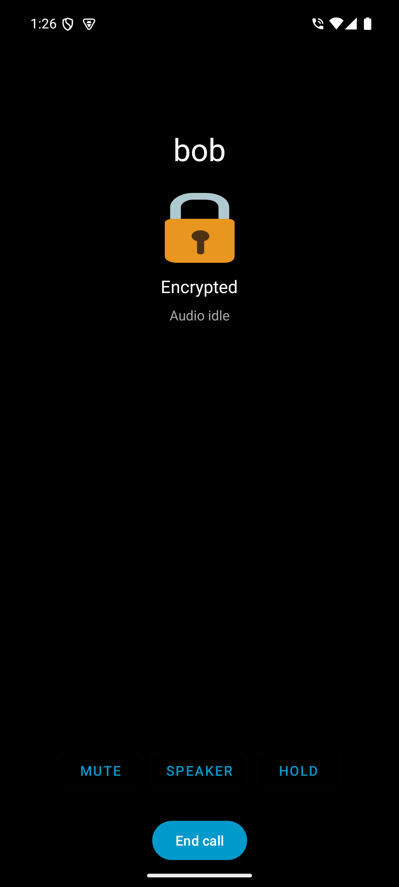
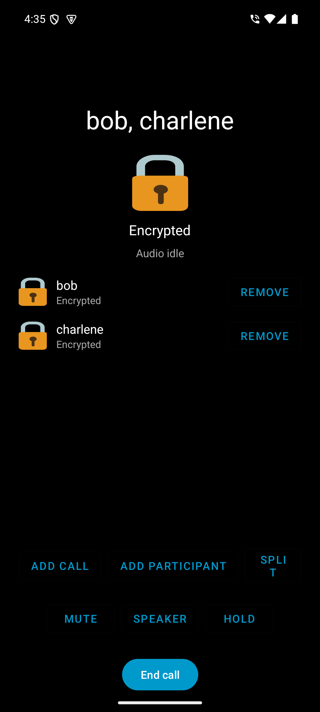
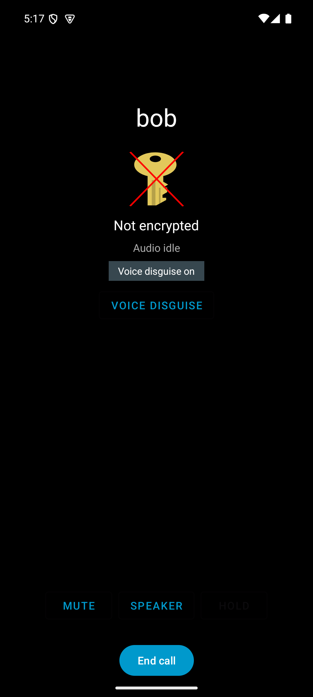

# Saga

Encrypted voice calling for Android — default dialer + Iroh transport.

**Canonical spec:** [saga-spec.md](saga-spec.md)

**Call-state icons:** [icons/](icons/) (AGPL — see [icons/readme.md](icons/readme.md))

| Component | Path |
|-----------|------|
| Android app | [`android/`](android/) |
| Native Iroh core (JNI) | [`saga-iroh-core/`](saga-iroh-core/) |
| Emulator E2E harness | [`testing/e2e/`](testing/e2e/) |
| Local Iroh relay (E2E/CI) | [`testing/iroh-relay/`](testing/iroh-relay/) |
| Test results (pass evidence) | [`docs/test-results.md`](docs/test-results.md) |
| Historical test log | [TEST_RESULTS.md](TEST_RESULTS.md) |
| Signed debug APK (local verify) | [`compiled/`](compiled/) |
| Gating CI | [`.github/workflows/ci.yml`](.github/workflows/ci.yml) |
| F-Droid (RFP + fdroiddata MR) | [`docs/fdroid/`](docs/fdroid/) |
| Store listing metadata | [`fastlane/metadata/`](fastlane/metadata/) |

## Table of contents

- [Status](#status)
- [What is Iroh?](#what-is-iroh)
- [Adding contacts](#adding-contacts)
- [Verifying downloads](#verifying-downloads)
- [Using GnuPG](#using-gnupg)
- [Recommended OS](#recommended-os)
- [Galdralag hardware](#galdralag-hardware)
- [Privacy: what Saga does and doesn't protect](#privacy-what-saga-does-and-doesnt-protect)
- [Testing approach (summary)](#testing-approach-summary)
- [Troubleshooting](#troubleshooting)

## Status

Current tagged preview: **`0.1.0-preview.2`** (`versionCode` 2), tag
[`v0.1.0-preview.2`](https://github.com/Supermagnum/saga/releases/tag/v0.1.0-preview.2).

Implementation runs on Android emulators with contact-based dialing and encrypted
Iroh calls, and has also been exercised on a **Samsung Galaxy Tab S6 Lite
(SM-P613)** as a physical peer (encrypted messaging and call answer; see
[`docs/test-results.md`](docs/test-results.md)). **Iroh group calls are supported
in release builds** (up to four participants with pairwise / mesh links; Add
participant on the in-call screen). Carrier (cellular) conference is separate and
unchanged where the device supports it. E2E Cases 1–10 (+ conference / onboarding)
pass with a **local dev relay** on API 35; API 29 is exercised each part. Push/PR
CI covers host Rust + Android debug with packaged `libsaga_iroh_core.so`;
two-emulator E2E stays local-only (see [testing/e2e/README.md](testing/e2e/README.md)).

F-Droid submission is open: [RFP #4874](https://gitlab.com/fdroid/rfp/-/work_items/4874)
and [fdroiddata !59255](https://gitlab.com/fdroid/fdroiddata/-/merge_requests/59255).
`applicationId` is `org.saga` (change before publish if a final ID is chosen).
See [`docs/fdroid/`](docs/fdroid/).

Peer long-term fingerprints and optional Iroh EndpointIds can be exchanged via
**My identity** in the app (QR code or `saga://add-contact` link). The peer
confirms before the key is written to Contacts; dial prefers a stored EndpointId
when present. Other intake paths: Saga keys list, NFC share/receive (when
hardware is present), and Galdra sync import.

See [`docs/test-results.md`](docs/test-results.md) for dated pass evidence (who
called whom, Encrypted / messaging). Historical run notes remain in
[TEST_RESULTS.md](TEST_RESULTS.md).

Preview APKs are on the
[GitHub Releases](https://github.com/Supermagnum/saga/releases) page. A signed
debug APK for local verify lives in [`compiled/`](compiled/) (`SHA256SUMS` +
GnuPG signature). See [Verifying downloads](#verifying-downloads) and
[Using GnuPG](#using-gnupg) before installing.

## What is Iroh?

[Iroh](https://www.iroh.computer/) is the peer-to-peer networking stack Saga uses for
encrypted voice calls and Saga-to-Saga messaging. It is built by [n0](https://n0.computer/)
and speaks **QUIC** end to end: peers address each other by cryptographic identity
rather than by a fixed IP or hostname.

**EndpointId.** Each Saga device has a long-lived Iroh **EndpointId** (public key
identity on the Iroh network). Dialing a peer means connecting to that EndpointId.
In this repo, debug/E2E builds often use stable phone-digit peer labels
(for example `15550100010`) that map to deterministic Iroh keys; production-style
ids are the usual Iroh hex / base32 forms. Contact rows store the *token*
fingerprint separately from the EndpointId (optional Contacts `DATA2`).

**Paths.** Iroh prefers a **direct** UDP/QUIC path when NAT allows it. When it
does not, traffic goes through a **relay** (public n0 relays by default, or a
local/custom relay for labs and E2E — see [`testing/iroh-relay/`](testing/iroh-relay/)).
**Discovery** of which address or relay can reach an EndpointId uses n0
**pkarr/DNS** (`dns.iroh.link` unless overridden).

**How Saga uses it.**

- The dialer places `saga:` calls via Contact keys / EndpointIds
  (`DialTargetResolver` → JNI in [`saga-iroh-core/`](saga-iroh-core/)).
- Call media rides **iroh-roq** (RTP over QUIC datagrams); after a successful
  token handshake, media is also protected with **SRTP** (end-to-end).
- Saga-to-Saga text uses a separate ALPN, `saga/msg/1`, with the same handshake
  and trust rules as voice.

Iroh moves packets; it does not by itself hide who you talk to or your IP. For
what relays, discovery, and your network can observe, see
[Privacy](#privacy-what-saga-does-and-doesnt-protect). Native build and feature
flags: [`saga-iroh-core/README.md`](saga-iroh-core/README.md).

## Adding contacts

Peer Saga keys live in Android Contacts as a custom MIME row. Every intake path
treats the key as **untrusted** until you confirm: compare the grouped fingerprint
**in person** (or another out-of-band channel) with the other person's screen
before saving.

| Path | How |
|------|-----|
| **QR / link** | **My identity** shows your fingerprint, EndpointId, QR, and a shareable `saga://add-contact?…` link. Paste or open the link on the peer; confirm, then attach to an existing contact or create one with a name. |
| **Saga keys** | List, rename (system Contacts name), move, or remove only the Saga key row. Paste a fingerprint or link to add. |
| **NFC** | On devices with `android.hardware.nfc` / `nfc.hce`: Share via NFC (HCE, armed only while that screen is open) or Receive via NFC. Hidden when the hardware is missing (for example Galaxy Tab S6 Lite SM-P613). Device-to-device HCE is not assumed tested on every form factor. |
| **Galdra import** | One-way import of a Galdra `sync export` SQLite file (Storage Access Framework). Only Brainpool P-256/P-384 verifying keys map to Saga fingerprints; others are marked not importable. Additive only — never deletes Contacts data. |

**OpenPGP / hardware tokens (separate from Saga contact fingerprints).** For managing
OpenPGP keys and tokens on Android, a current F-Droid candidate is
[PGPony](https://f-droid.org/packages/com.pgpony.android/) (`com.pgpony.android`) —
OpenPGP with hardware security key support and an OpenKeychain-compatible API.
Checked **2026-11-26** against F-Droid. Do **not** use OpenKeychain (maintenance
mode since 2021). PGPony helps with token/OpenPGP setup; it does **not** replace
Saga's contact fingerprint. The OpenPGP v4 fingerprint GnuPG/PGPony show is a
**different value** from Saga's ephemeral-session contact fingerprint (SHA-256 of
the Brainpool AUT SEC1 key). Saga needs Brainpool P-256/P-384 AUT on Nitrokey —
confirm that workflow against current PGPony docs when provisioning a card.

## Verifying downloads

Release APKs are signed with the maintainer Android keystore. Before installing a
preview build from GitHub:

1. Download the APK and the matching `SHA256SUMS` file from the same release
   (and `SHA256SUMS.asc` when present).
2. Prefer verifying the sums file with GnuPG first — see
   [Using GnuPG](#using-gnupg) — then check the file hash:
   `sha256sum -c SHA256SUMS` (or compare the APK line manually).
3. Confirm the **APK signing certificate** SHA-256 matches the fingerprint below
   (not only the APK file hash).

**Signing certificate SHA-256** (hex, no colons):

`7a6a218e8a497a51232ca11c9a10b362769c4969fa7dd26b359838a08cb7dd9a`

Colon form (for some UIs):

`7A:6A:21:8E:8A:49:7A:51:23:2C:A1:1C:9A:10:B3:62:76:9C:49:69:FA:7D:D2:6B:35:98:38:A0:8C:B7:DD:9A`

### AppVerifier (recommended on GrapheneOS)

[App Verifier](https://github.com/GrapheneOS/AppVerifier) (also available via
the GrapheneOS App Store) checks an APK’s signing certificate against a known
fingerprint.

1. Install App Verifier from a trusted source (GrapheneOS App Store preferred).
2. Open the downloaded Saga APK with App Verifier (or share the file into it).
3. Compare the shown certificate SHA-256 to the fingerprint above.
4. Only proceed with install if they match exactly.

You can also check with Android build-tools:

```bash
apksigner verify --print-certs path/to/saga-….apk
# Expect Signer #1 certificate SHA-256 digest:
# 7a6a218e8a497a51232ca11c9a10b362769c4969fa7dd26b359838a08cb7dd9a
```

Unsigned build and signing steps for maintainers: [docs/release.md](docs/release.md).

### Screenshots (emulator)

| | |
|--|--|
| Encrypted call |  |
| Group call (supported in release) |  |
| Voice disguise |  |

## Using GnuPG

[GnuPG](https://gnupg.org/) (`gpg`) checks that a detached signature was made by
a known key. Saga uses it for `compiled/SHA256SUMS.asc` (and the same pattern for
release `SHA256SUMS` when published). This is separate from the Android APK
signing certificate above, and separate from Nitrokey / OpenPGP Aut keys used
inside Saga calls.

**Trust the fingerprint only** — ignore any name or email GnuPG may print from a
key’s local user ID packet.

| Field | Value |
|-------|-------|
| OpenPGP fingerprint | `80EF2F63B22E9BC26E63B3DC80788803ED4C7A02` |

**1. Install GnuPG** (if needed): Debian/Ubuntu `sudo apt install gnupg`; Fedora
`sudo dnf install gnupg2`; macOS `brew install gnupg`.

**2. Obtain the public key** out of band (keyserver, or a copy you already trust),
then confirm the fingerprint:

```bash
gpg --recv-keys 80EF2F63B22E9BC26E63B3DC80788803ED4C7A02
# or: gpg --import path/to/pubkey.asc
gpg --fingerprint 80EF2F63B22E9BC26E63B3DC80788803ED4C7A02
```

Proceed only if the fingerprint matches exactly.

**3. Verify a detached signature** next to `SHA256SUMS`:

```bash
cd compiled   # or the directory with the downloaded release files
gpg --verify SHA256SUMS.asc SHA256SUMS
```

Expect a good signature whose **primary key fingerprint** is the value above.
GnuPG may still print `WARNING: This key is not certified with a trusted
signature!` until you assign local trust; that does not mean the signature
failed.

**4. Check the APK hash** after the signature verifies:

```bash
sha256sum -c SHA256SUMS
```

**5. Optional — mark the key as ultimately trusted locally** (only after the
fingerprint matches):

```bash
gpg --edit-key 80EF2F63B22E9BC26E63B3DC80788803ED4C7A02
# then: trust  →  5  →  y  →  quit
```

For Android OpenPGP card management (Nitrokey), prefer
[PGPony](https://f-droid.org/packages/com.pgpony.android/) rather than desktop
GnuPG alone; see [Adding contacts](#adding-contacts).

## Recommended OS

[GrapheneOS](https://grapheneos.org/) is the preferred Android OS for running Saga.
It provides a hardened security model relative to typical Android builds, and it
includes a duress PIN/password feature. Saga does not require GrapheneOS, but it
is the recommended environment when choosing a device OS.

## Galdralag hardware

[Galdralag](https://github.com/Supermagnum/Galdralag-firmware) is the open
hardware security token Saga targets for on-token ephemeral key exchange
(stronger than the current Nitrokey path where the ephemeral private key
exists briefly in phone memory during the handshake).

**Galdralag hardware support in Saga is waiting on**
[betrusted-io/xous-core#937](https://github.com/betrusted-io/xous-core/pull/937)
to be resolved. When that pull request is closed or merged, Saga will add
Galdralag support. Until then, Encrypted calls require a supported Nitrokey
OpenPGP card; Galdralag devices are not usable with Saga yet.

## Privacy: what Saga does and doesn't protect

Saga encrypts **call content** end to end on Encrypted Iroh calls (SRTP after a
token-authenticated handshake), and **Saga-to-Saga text** on a separate Iroh
ALPN (`saga/msg/1`) with the same handshake and trust rules. It does **not**
hide who you talk to, your IP address, or call/message timing/volume. Do not
treat Saga as a way to stay untraceable on the network. Carrier SMS/MMS is out
of scope (Saga does not take `ROLE_SMS`).

Opus audio uses **constant bitrate (CBR, 32 kbps)** with DTX off, so encrypted
packet sizes do not follow speech content. Text ciphertexts are padded to fixed
size buckets (256 B / 1 KB / 4 KB) for the same reason. That removes one
traffic-analysis leak; it does not hide that a call or message exchange is
happening.

### What is exposed today

Iroh prefers a **direct** peer path when NAT allows it, and falls back to a
**relay** when it does not. Discovery uses n0 pkarr/DNS (`dns.iroh.link`) unless
you override the relay for labs. DNS on Android goes through the platform
`DnsResolver` (Private DNS, VPN, and Orbot are honoured; Saga does not pin a
third-party resolver).

| Who | What they can see | What they cannot see |
|---|---|---|
| **The person you call or message** | Your public IP when the session connects **directly** (preferred when possible) | Call/message content on Encrypted sessions |
| **Relay operator (n0, when a session is relayed)** | Both parties' IP addresses, EndpointIds, timing, duration, and data volume | Call/message content (end-to-end encrypted) |
| **Discovery service (n0 DNS/pkarr)** | Lookups/publishes for a Saga EndpointId (that someone is trying to reach or announce a given identity), and from which IP | Content; whether a dial or message actually connected |
| **Your DNS resolver** | Which discovery/relay hostnames are looked up (Private DNS hides this from your ISP, not from the resolver operator) | Call/message content |
| **Your ISP / network operator** | That you connect to relays or to a peer's IP, plus timing and volume | Call/message content |
| **Anyone correlating sessions** | Saga EndpointIds are long-lived, so lookups, calls, and messages can be linked over time | — |
| **Carrier (normal phone calls / SMS)** | Everything on the phone-network path: those are never encrypted by Saga | — |

### Hardware token and forward secrecy

With a **Nitrokey**, Saga has per-call forward secrecy: a fresh ephemeral key is
generated on the phone for each call and discarded afterwards; the long-term key
stays on the card and only signs the ephemeral offer. The ephemeral private key
exists briefly in **phone memory** during the handshake — that is a weaker window
than on-token ECDH.

**Galdralag** (and a possible future Nitrokey on **Baochip-1x**, the same chip
family as Galdralag's Dabao target) does the ephemeral key exchange inside the
token, so the ephemeral key never leaves the hardware. Track Baochip-1x Nitrokey
support only when such a device exists; no work until then.

### Recommended mitigation: a privacy-focused VPN

Until a suitable low-latency Rust crate for IP/metadata protection exists, use a
**system-wide VPN** from a privacy-focused provider (**not yet verified with a
VPN**). Turn on Android **Always-on VPN** and **Block connections without VPN**
so Saga never dials outside the tunnel if the VPN drops. Saga respects the
phone's VPN and Private DNS settings.

**What a VPN changes:** the person you call, the relay operator, and your ISP see
the VPN exit address instead of yours.

**What it does not change:** the VPN provider can see your real IP and which
relays/peers you connect to; timing and volume metadata remain. Choose a
provider you trust. Tor is not suitable (latency too high for live voice; no
UDP/QUIC path for this stack).

#### Suitable providers (run by privacy advocates)

| Provider | Based in | Sign-up | Anonymous payment | No-logs verification | Notes |
|---|---|---|---|---|---|
| **Mullvad VPN** | Sweden | Random account number, no email | Cash by post, Monero, Bitcoin | Public audits (Cure53, KPMG) | WireGuard; open-source apps |
| **IVPN** | Gibraltar | Random account ID, no email | Cash, Monero, Bitcoin | Cure53 audit | WireGuard; open-source apps |
| **Proton VPN** | Switzerland | Email required (a disposable one works) | Bitcoin (no cash/Monero) | Annual Securitum audits | Open-source apps; free tier available |
| **RiseupVPN** | Riseup collective (since 1999) | No account | Free, donation-funded | No external audit | Bitmask client (OpenVPN); on F-Droid |
| **CalyxVPN** | Calyx Institute (non-profit) | No account | Free | No external audit | Bitmask client (OpenVPN); client and server open source |
| **NymVPN** | Decentralised network | See provider | See provider | — | Use only the fast **two-hop** mode for calls; mixnet mode adds too much delay for live voice |

This table is a starting point, not an endorsement. Re-check each provider's
current policies and audits before relying on them; review the list about once a
year.

**Guidance:**

- Prefer **WireGuard** (UDP) for calls; it usually adds less delay. OpenVPN-based
  services (Riseup, Calyx) work but may add latency, and free capacity can be
  slower when busy.
- Pay without linking a bank card where possible (cash, Monero): card payment
  ties your identity to the account.
- Use Always-on VPN + block connections without VPN.
- Also recommended: GrapheneOS, and Private DNS on (see [Troubleshooting](#troubleshooting)).
- See [docs/design/relay-options.md](docs/design/relay-options.md) for relay/
  discovery metadata detail and a short note on future Rust IP-protection options.

## Testing approach (summary)

E2E uses **two AVDs** (`emulator-5554` = alice, `emulator-5556` = bob), `adb`, and the scripts under `testing/e2e/`. Calls are placed by **contact display name** (`bob`, `alice`, `thor`), not raw peer labels.

| What | Why |
|------|-----|
| **Local `iroh-relay --dev`** on host port 3340 (`http://10.0.2.2:3340` from emulators) | Public N0 relays (`*.relay.n0.iroh.link`) caused intermittent `endpoint.online()` stalls (up to 120s) under rapid automated restarts; local relay gives stable ~3s registration and avoids hammering shared public infrastructure during CI-style runs. |
| **Native `pollRelayReady()` (JNI)** | Relay gating reads `endpoint.online()` completion in Rust, not logcat markers. Logcat-as-IPC caused false pass/fail races (stale markers, clear-then-hope). |
| **Phone-digit contact keys** (`15550100010` / `15550100011`) | Replaces legacy `bobpeer12` labels; aligns contact keys, dev identity, and InCall registry keys. |
| **Standalone case runs** (`run-case-standalone.sh`) | Cases 3–6 verified individually from clean boot before relying on full-suite ordering. |

Quick start:

```bash
# Start local relay (once per host session)
bash testing/iroh-relay/start-local-relay.sh

# Full suite (builds APK, seeds contacts, Cases 1–7)
SERIAL_A=emulator-5554 SERIAL_B=emulator-5556 bash testing/e2e/run-e2e-full.sh
```

Use `SAGA_IROH_RELAY_MODE=public` to exercise public N0 relays for comparison (expect more variance).

Details: [testing/e2e/README.md](testing/e2e/README.md).

## Troubleshooting

### Public N0 relays fail with TLS `UnknownIssuer` or never go online

Some ISP “safe browsing” resolvers (e.g. Telenor Nettvern) hijack lookups for
`*.relay.n0.iroh.link` / `dns.iroh.link` and return a captive portal certificate.
Iroh then fails TLS probes (`UnknownIssuer`) and `endpoint.online()` never
completes.

Saga installs `ndk_context` (`IrohNativeBridge.installAndroidContext`) and
routes iroh DNS through `android.net.DnsResolver` (`AndroidDnsBridge`) so
A/AAAA/TXT honour **Private DNS (DoT), VPN, and Orbot**. It does **not** pin
Cloudflare/Google (or any) resolvers in-app: that would leak every discovery
hostname lookup and override the user’s DNS settings.

**What helps:**

| Approach | Effect |
|----------|--------|
| Android **Private DNS** (DoT), e.g. `one.one.one.one` | Platform `DnsResolver` uses DoT; bypasses ISP recursive hijacks (e.g. Telenor Nettvern → captive `UnknownIssuer`) |
| Clean recursive DNS / VPN / Orbot | Same path — Saga uses the active network’s platform resolver |
| Local / custom relay (`saga_iroh_relay`) | Avoids public N0 hostnames for the call path |
| Host `saga-peer` soak `bwrap` + clean `resolv.conf` | Applies only to the Linux peer binary, not the Android app |

If public N0 never becomes reachable and the call fails with **Not reachable**
within the connect budget (~18s), check Private DNS / VPN. Saga must not hang
silently on hijacked DNS.

See also [docs/design/relay-options.md](docs/design/relay-options.md) (discovery
metadata: what relay, pkarr/DNS, and the recursive resolver each observe).
